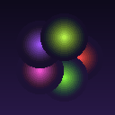
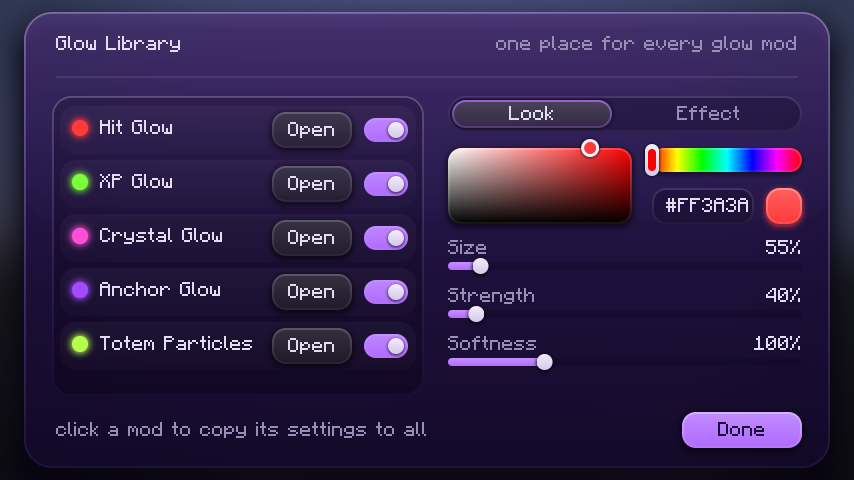
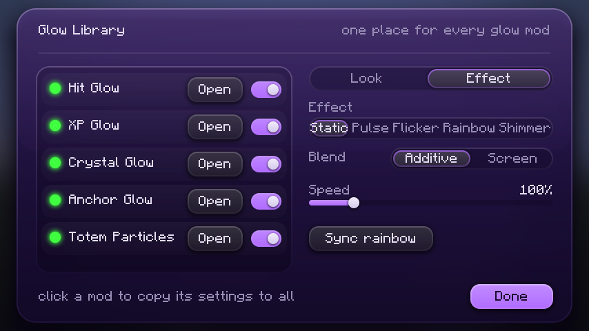

# Glow Library

one menu for the wysss glow mods (hit glow, xp glow, crystal glow, anchor glow, totem particle glow). client side fabric mod for 1.21.11, needs fabric api and [Wysss Library](https://github.com/realwysss/Wysss-Library). press **L**.

- switch each glow on or off and open its own menu
- apply color, size, strength, softness, effect, blend and speed to all glow mods at once
- copy the settings of one glow mod to all the others
- sync the rainbow effect so every glow cycles the same colors

## download

| jar | minecraft |
|---|---|
| `glow-library-mc1.21.11-1.0.0.jar` | 1.21.11 |

on the releases page.

## pictures

## license

all rights reserved, made by wysss.
